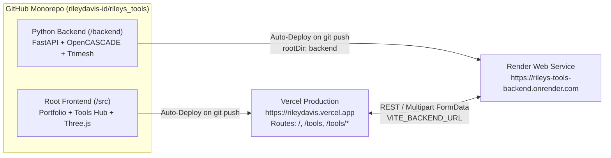

# Riley Davis — Software Engineering Portfolio & Unified Python Tool Hub (`rileys_tools`)

Personal Software & Systems Engineering Portfolio and Interactive Tool Lab hosted at **[rileydavis.vercel.app](https://rileydavis.vercel.app)**, backed by a unified modular Python FastAPI service on **Render** at **[rileys-tools-backend.onrender.com](https://rileys-tools-backend.onrender.com)**.

---

## Live Links & Dashboards

| Resource | URL |
| :--- | :--- |
| **Portfolio Home (`Vercel`)** | [https://rileydavis.vercel.app/](https://rileydavis.vercel.app/) |
| **Interactive Tools Directory (`Vercel`)** | [https://rileydavis.vercel.app/tools](https://rileydavis.vercel.app/tools) |
| **STEP → STL Converter Subpage (`Vercel`)** | [https://rileydavis.vercel.app/tools/step-to-stl](https://rileydavis.vercel.app/tools/step-to-stl) |
| **3D Mesh Inspector Subpage (`Vercel`)** | [https://rileydavis.vercel.app/tools/mesh-inspector](https://rileydavis.vercel.app/tools/mesh-inspector) |
| **Unified Python Backend API (`Render`)** | [https://rileys-tools-backend.onrender.com](https://rileys-tools-backend.onrender.com) |
| **Interactive Swagger / OpenAPI Docs** | [https://rileys-tools-backend.onrender.com/docs](https://rileys-tools-backend.onrender.com/docs) |
| **Backend Health Check JSON** | [https://rileys-tools-backend.onrender.com/api/health](https://rileys-tools-backend.onrender.com/api/health) |
| **Registered Tools Catalog JSON** | [https://rileys-tools-backend.onrender.com/api/tools](https://rileys-tools-backend.onrender.com/api/tools) |
| **GitHub Repository** | [https://github.com/rileydavis-id/rileys_tools](https://github.com/rileydavis-id/rileys_tools) |
| **Render Service Dashboard** | [https://dashboard.render.com/web/srv-dbiku8utlv9c73b131v0](https://dashboard.render.com/web/srv-dbiku8utlv9c73b131v0) |
| **Vercel Project Inspector** | [https://vercel.com/rileydavis/rileydavis](https://vercel.com/rileydavis/rileydavis) |

---

## Site Map & Multi-Page Navigation Flow

The frontend implements clean History API path routing (`window.history.pushState` + `popstate`) paired with a Vercel SPA rewrite rule (`vercel.json`) so every route works both via in-app navigation and on direct browser refresh:

1. **Portfolio Home (`/`)**:
   - **Personal Engineer Hero**: Profile badge, engineering bio, quick navigation buttons (**Explore Interactive Tools**, **View Engineering Projects**, **@rileydavis-id**), and an interactive terminal preview card (`riley@engineering-lab:~`).
   - **Technical Focus & Stack Bento Grid**: 4-column overview across *Python Backend & APIs*, *CAD & Computational Geometry*, *Interactive Web & 3D Graphics*, and *Cloud & CI/CD Automation*.
   - **Featured Engineering Projects**: Detailed project cards for the *OpenCASCADE STEP-to-STL Converter* and *3D Mesh Printability Inspector*, with buttons to navigate to the `/tools` hub or open each tool's subpage directly.
   - **Interactive Tooling Hub Callout & Global Footer**.
2. **Interactive Tools Directory (`/tools`)**:
   - Searchable and filterable catalog of all Python tools registered on the shared Render backend.
   - Each active tool card displays its category, status badge, REST API endpoints, and an **Open Tool →** button that routes to its dedicated subpage.
   - Includes a live Render Backend Endpoint configuration bar and instructions for adding new tools.
3. **Tool Subpages (`/tools/step-to-stl` & `/tools/mesh-inspector`)**:
   - Dedicated full-screen tool workspaces with a **← Back to Tools** breadcrumb bar and API route indicator.

---

## System Architecture

All frontend pages live on **Vercel (`rileydavis.vercel.app`)** and all Python backend workloads run on a single shared **Render Web Service (`rileys-tools-backend`)**:



### Repository Structure

```text
rileys_tools/
├── README.md                        # Full project, architecture, setup, and changelog docs
├── package.json                     # Frontend dependencies (React 19, Three.js, Lucide, Vite)
├── tsconfig.json                    # TypeScript configuration
├── vite.config.ts                   # Vite bundler config
├── vercel.json                      # Vercel build config + SPA rewrites for /tools & /tools/*
├── .vercelignore                    # Excludes /backend from Vercel frontend builds
├── render.yaml                      # Render Blueprint IaC definition for rileys-tools-backend
├── index.html                       # Root HTML entry point + SVG favicon
├── src/                             # Frontend application (deployed to rileydavis.vercel.app)
│   ├── main.tsx                     # React DOM root
│   ├── App.tsx                      # Portfolio Home (/), Tools Directory (/tools), and subpage router
│   ├── config.ts                    # Backend URL resolution & fallback tool catalog metadata
│   ├── samplePrecomputed.ts         # Precomputed OpenCASCADE STL cache for instant cold-start load
│   ├── styles.css                   # Portfolio & dark CAD studio UI theme
│   └── components/
│       ├── StlViewer3D.tsx          # Three.js WebGL 3D STL viewport (OrbitControls, Z-slicer, 5 shaders)
│       ├── StepToStlTool.tsx        # STEP -> STL converter UI, deflection controls, raw STEP viewer
│       └── MeshInspectorTool.tsx    # 3D mesh printability, normal repair, PLA weight & unit scaler
└── backend/                         # Unified Python backend (deployed to Render)
    ├── .python-version              # Pins Python 3.12
    ├── requirements.txt             # Python dependencies (FastAPI, Uvicorn, cascadio, trimesh, numpy)
    └── app/
        ├── main.py                  # FastAPI app, CORS, /api/health, /api/tools auto-router mount
        └── tools/
            ├── registry.py          # Central ToolRegistry & ToolMetadata definitions
            ├── step_to_stl.py       # OpenCASCADE STEP-to-STL converter + ISO-10303-21 sample builders
            └── mesh_inspector.py    # Trimesh printability analyzer, normal fixer & mm/inch scaler
```

---

## Active Tools Hosted in This Repo

### 1. STEP to STL Converter & 3D CAD Visualizer (`/tools/step-to-stl` → `/api/tools/step-to-stl`)
- **CAD Kernel**: Uses [`cascadio`](https://pypi.org/project/cascadio/) (Cython bindings to the OpenCASCADE C++ B-Rep kernel) and [`trimesh`](https://trimesh.org/) to parse `.step`, `.stp`, `.igs`, and `.iges` solid models and tessellate them into watertight triangle meshes.
- **Unit Normalization**: `cascadio` exports glTF/GLB in meters per the glTF 2.0 specification; `convert_step_bytes_to_mesh()` scales the resulting mesh by `×1000.0` so exported `.stl` files preserve exact CAD millimeter (`mm`) dimensions for 3D printing and CAM slicers.
- **Built-in ISO-10303-21 AP214 Sample Generator**: Generates real `MANIFOLD_SOLID_BREP` / `ADVANCED_FACE` / `EDGE_LOOP` STEP files on demand (`CNC Gusseted L-Bracket`, `T-Slot Mill Table Clamp Block`, `Hexagonal Drive Coupler`) so users can test end-to-end conversion and inspect the raw STEP source without needing a local CAD file.
- **Interactive 3D Confirmation Viewport (`StlViewer3D.tsx`)**:
  - **Shading Modes**: `CAD + Edges` (feature crease lines + triangle tessellation overlay), `Studio` (metallic 3-point lighting), `Wireframe`, `Normals` (surface normal vector check), and `X-Ray` (translucent internal inspection).
  - **Camera Presets**: `Iso`, `Front`, `Top`, `Right`, plus turntable `Spin`, 10 mm build-plate `Grid`, and `Bounds` envelope cage.
  - **Z-Section Slicer**: Real-time WebGL clipping plane slider (`5%–100%`) to slice vertically through the converted part and confirm internal geometry.

### 2. 3D Mesh Printability Inspector & Unit Scaler (`/tools/mesh-inspector` → `/api/tools/mesh-inspector`)
- **Manifold & Winding Verification**: Checks watertightness (`is_watertight`), Euler characteristic ($\chi$), and repairs inconsistent face winding normals (`trimesh.repair.fix_winding`).
- **Metrology & Filament Estimation**: Computes volume ($\text{mm}^3$ and $\text{cm}^3$), surface area, center of mass, and estimated PLA filament weight at 20% infill and 100% solid ($1.24\text{ g/cm}^3$).
- **Unit Scaling**: One-click scaling between `1:1`, `Inch → mm (×25.4)`, and `mm → Inch (÷25.4)`.

---

## How This Project Was Set Up (End-to-End Provisioning Log)

### 1. Local Tooling & Environment Setup
The following CLI tools were configured on Windows:
- **Python & `uv`**: Python 3.12 (`C:\Users\Riley\.local\bin\python3.12.exe`) managed by `uv` (`C:\Users\Riley\.local\bin\uv.exe`).
- **Node.js & npm**: Node.js `v24.15.0` and `npm 11.12.1`.
- **Git**: Portable MinGit `2.56.0` installed to `C:\Users\Riley\.local\mingit\cmd` and added to the user `PATH`.
- **GitHub CLI (`gh`)**: `v2.103.3`, authenticated as `rileydavis-id` via `gh auth login --hostname github.com --git-protocol https --web` and configured as the Git credential helper via `gh auth setup-git`.
- **Vercel CLI (`vercel`)**: `v65.9.0`, authenticated as `rileydavis-id` under team scope `rileydavis` (`team_yDxyHVDO1N94TDEKrfcxG3ov`).
- **Render CLI (`render`)**: `v2.34.0`, authenticated as `dubbleg.riley@gmail.com` (`usr-dbikcdk9v7es73frm6m0`) with active workspace set to `My Workspace` (`tea-dbikcdk9v7es73frm6f0`).

### 2. Git & GitHub Repository Creation
From `c:\Users\Riley\Desktop\coding projects\rileys_tools`:
```powershell
git init -b main
git config user.name "Riley Davis"
git config user.email "dubbleg.riley@gmail.com"
git add .
git commit -m "Initial commit: Riley's Tools hub + OpenCASCADE STEP-to-STL converter"

# Create public GitHub repo and push main
gh repo create rileydavis-id/rileys_tools --public --source=. --remote=origin --push
```

### 3. Unified Render Backend Provisioning (`rileys-tools-backend`)
The backend service was created on Render pointing to the `backend` subdirectory of the GitHub repository:
```powershell
render workspace set tea-dbikcdk9v7es73frm6f0 --confirm

render services create `
  --name rileys-tools-backend `
  --type web_service `
  --repo https://github.com/rileydavis-id/rileys_tools `
  --branch main `
  --root-directory backend `
  --runtime python `
  --plan free `
  --build-command "pip install -r requirements.txt" `
  --start-command "uvicorn app.main:app --host 0.0.0.0 --port `$PORT" `
  --health-check-path "/api/health" `
  --env-var "PYTHON_VERSION=3.12.7" `
  --confirm -o json
```
- **Render Service ID**: `srv-dbiku8utlv9c73b131v0`
- **Public Render URL**: `https://rileys-tools-backend.onrender.com`
- **Auto-Deploy**: Enabled on every push to `main`.

### 4. Vercel Website Deployment (`rileydavis.vercel.app`)
The root Vite application was linked to the `rileydavis` project on Vercel (which assigns the `rileydavis.vercel.app` production domain), connected to the GitHub repository, and configured with `VITE_BACKEND_URL`:
```powershell
# Link local repo to Vercel project 'rileydavis'
vercel link --project rileydavis --scope rileydavis --yes

# Connect GitHub repository for automatic deployments on git push
vercel git connect https://github.com/rileydavis-id/rileys_tools --yes --scope rileydavis

# Set production backend environment variable
"https://rileys-tools-backend.onrender.com" | vercel env add VITE_BACKEND_URL production --yes --scope rileydavis

# Deploy to production (https://rileydavis.vercel.app)
vercel deploy --prod --yes --scope rileydavis
```
> **Note on `.vercelignore` and `vercel.json`**: Because the repo contains `render.yaml` and `backend/`, `.vercelignore` excludes `backend/` so Vercel builds only the Vite frontend at the repository root while Render builds `backend/`.

---

## How to Add a New Tool to `rileydavis.vercel.app` & Render

Adding a new tool to both the website and the shared Render backend takes 3 steps:

### Step 1: Create a Python Router in `backend/app/tools/<your_tool>.py`
Create a new file (for example, `backend/app/tools/gcode_estimator.py`) and register it with `registry`:

```python
from fastapi import APIRouter
from .registry import ToolEndpointDoc, ToolMetadata, registry

router = APIRouter(prefix="/api/tools/gcode-estimator", tags=["G-Code Estimator"])


@router.post("/parse")
async def parse_gcode(payload: dict) -> dict:
    # Your Python tool logic here
    return {"status": "ok", "layers": 120}


registry.register(
    ToolMetadata(
        id="gcode-estimator",
        name="G-Code Toolpath & Print Time Analyzer",
        slug="gcode-estimator",
        category="CAD & 3D Manufacturing",
        description="Parse 3D printer G-code layer times, retraction counts, and filament feed rates.",
        version="1.0.0",
        status="active",
        icon="cpu",
        tags=["G-Code", "CNC", "FDM"],
        endpoints=[
            ToolEndpointDoc("POST", "/api/tools/gcode-estimator/parse", "Analyze uploaded G-code"),
        ],
    ),
    router,
)
```

### Step 2: Import the Tool Module in `backend/app/main.py`
Add the module to the import line in `backend/app/main.py` so it registers at startup:
```python
from .tools import step_to_stl, mesh_inspector, gcode_estimator  # noqa: F401
```
*(If your tool requires a new Python package, add it to `backend/requirements.txt`.)*

### Step 3: Add the Frontend Subpage Route in `src/App.tsx` and Push
1. Create your React UI component in `src/components/GcodeEstimatorTool.tsx` calling `${backendUrl}/api/tools/gcode-estimator/parse`.
2. Add its subpage route (`/tools/gcode-estimator`) in `src/App.tsx`.
3. Update `README.md` with the new tool details and commit with descriptive notes:
   ```powershell
   git add .
   git commit -m "Add G-code estimator tool" -m "Detailed commit notes..."
   git push origin main
   ```
Both **Render** (`rileys-tools-backend.onrender.com`) and **Vercel** (`rileydavis.vercel.app`) will automatically build and deploy your new tool.

---

## Running Locally for Development

### 1. Start the Python FastAPI Backend (`http://localhost:8000`)
```powershell
cd "c:\Users\Riley\Desktop\coding projects\rileys_tools\backend"

# Create venv & install dependencies (first time only)
uv venv .venv --python 3.12
uv pip install -r requirements.txt --python .\.venv\Scripts\python.exe

# Run FastAPI with hot-reload on port 8000
.\.venv\Scripts\python.exe -m uvicorn app.main:app --reload --host 127.0.0.1 --port 8000
```
- Local Swagger UI: `http://localhost:8000/docs`

### 2. Start the Vite + React Frontend (`http://localhost:5173`)
```powershell
cd "c:\Users\Riley\Desktop\coding projects\rileys_tools"
npm install
npm run dev
```

---

## Project Changelog & Git Commit Log

| Commit | Summary & Notes |
| :--- | :--- |
| `2b6d8e6` | **Initial commit: Riley's Tools hub + OpenCASCADE STEP-to-STL converter** — Created monorepo with FastAPI backend (`backend/`), `ToolRegistry`, OpenCASCADE `step_to_stl` router, `mesh_inspector` router, and React + Three.js 3D STL visualizer (`src/`). |
| `73d6e9c` | **Add OpenCASCADE sample precomputed cache and favicon** — Added `src/samplePrecomputed.ts` and client-side Three.js fallback so the 3D visualizer renders immediately even during Render free-tier cold starts. |
| `6c249e5` | **Configure clean Vite `vercel.json` and `.vercelignore`** — Excluded `backend/` from Vercel builds so Vercel builds the Vite frontend (`rileydavis.vercel.app`) while Render builds `backend/` (`rileys-tools-backend.onrender.com`). |
| `f0adccc` | **Document full setup, CLI tooling, architecture, and tool extension guide in `README.md`** — Added architecture diagram, provisioning commands, and developer guide. |
| `3a70eb3` | **Add clean Home page, Tools directory page, and dedicated tool subpages** — Added History API routing (`/`, `/tools`, `/tools/step-to-stl`, `/tools/mesh-inspector`) and SPA rewrite rules in `vercel.json`. |
| `8ab31c6` | **Redesign Home page as Riley Davis Software Engineering Portfolio + Live Tool Lab** — Added personal engineer hero, interactive terminal card (`riley@engineering-lab:~`), 4-column Technical Focus & Stack bento grid, Featured Engineering Projects showcase, and global portfolio footer. |
